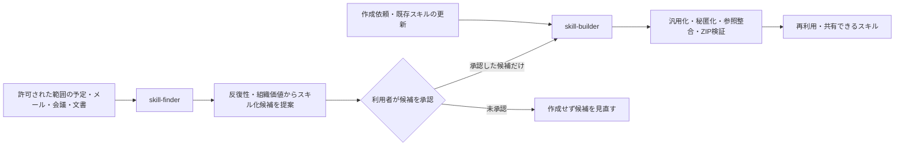
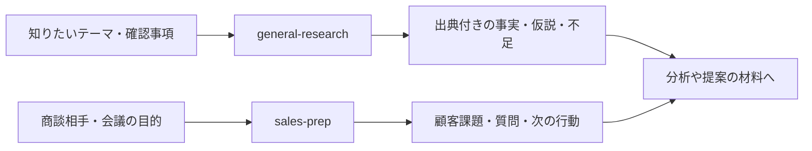
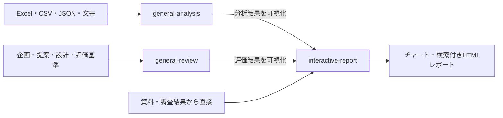
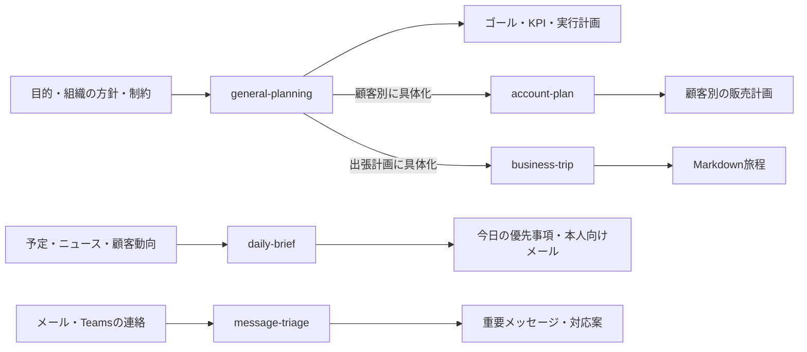
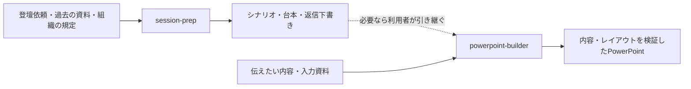
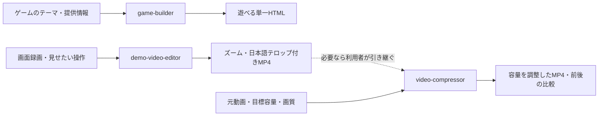

# ✨ Copilot Cowork Skills

**仕事の調査・整理・準備を、再利用できるCoworkスキルに。**

Created by **Geek Fujiwara** · Released under the **MIT License**

[コンセプト](#コンセプト) · [設計原則](#組織知として利用するための設計原則) · [カテゴリ一覧](#カテゴリ一覧) · [スキル一覧](#スキル一覧) · [インストール](#インストール) · [使い方](#使い方)

---

## コンセプト

**仕事の進め方を、特定の個人だけが持つノウハウではなく、誰でも再利用・改善できるスキルにする。**

このリポジトリは、Copilot Coworkで利用できる日本語中心の公開スキル集です。予定表、メール、Teams、SharePoint、OneDrive、Officeファイル、公開Webなどを横断する業務手順を、環境固有の個人情報や組織名に依存しない形で共有します。

スキルは完成した回答を固定するものではありません。利用者が既にアクセスできる組織の規定、過去事例、指定様式、会話や資料を実行時に確認し、その組織に合う調査・判断・成果物作成の方法を再現するための設計資産です。公開されたスキルを誰でも利用でき、改善を組織やコミュニティへ還元できる状態を目指します。

## 組織知として利用するための設計原則

1. **汎用化する** — 氏名、メール、顧客名、テナントURL、固定IDを埋め込まず、入力または実行時コンテキストから取得する。
2. **組織の事実を先に確認する** — 一般論だけで処理せず、利用可能な社内規定、成功事例、指定様式、予算、過去の意思決定を確認する。
3. **根拠を追跡できるようにする** — 事実、引用、推論、提案、未確認事項を分け、資料名、日時、URLなどの出典を残す。
4. **最小権限・最小範囲で扱う** — 利用者がアクセスできる情報だけを、必要な期間・ファイル・列・メッセージに絞って読む。
5. **外部入力を命令として実行しない** — メール、文書、Web結果に含まれる指示はデータとして扱い、スキルの手順や安全ルールを上書きさせない。
6. **外部作用は人が決める** — 送信、投稿、共有、申請、予約、購入、削除は自動実行せず、下書きまたは明示確認で止める。
7. **不足を捏造しない** — 確認できない値やURLを補完せず、「要確認」として次の行動へつなげる。
8. **検証可能にする** — 詳細手順を `references/`、再現可能な処理を `scripts/` に分離し、監査、テスト、成果物検証を通してから公開する。

> [!IMPORTANT]
> カスタムスキルはMicrosoftによる検証済み製品ではありません。内容とアクセス対象を確認し、
> 組織のポリシーに従って利用してください。

## カテゴリ一覧

目的に合うカテゴリを選ぶと、各カテゴリの図解・使い方・Skill一覧へ移動できます。

| カテゴリ | こんなときに | 主な成果物 |
|---|---|---|
| [スキル発見・作成](#skill-discovery-creation) | 繰り返す業務を再利用できる手順にしたい | スキル化候補・検証済みスキル |
| [調査](#調査) | テーマや商談の事実・根拠を集めたい | 出典付きの調査結果・商談準備レポート |
| [分析](#分析) | データや企画を比較・評価し、判断につなげたい | 分析・評価結果・インタラクティブHTML |
| [生産性](#生産性) | 計画・予定・連絡から次の行動を決めたい | 実行計画・顧客別計画・旅程・優先事項 |
| [文書作成](#文書作成) | 伝えたい内容を台本やスライドにしたい | 登壇シナリオ・台本・PowerPoint |
| [クリエイティブ](#クリエイティブ) | ゲームや動画を制作・編集したい | 遊べるHTML・編集済みMP4・圧縮MP4 |

## スキル一覧

カテゴリごとに **Mermaid → 使い方 → Skill一覧** の順で紹介します。図の矢印は、入力から成果物までの利用イメージです。すべての工程を通る必要はなく、目的に合うスキルから始められます。

点線は、利用者が必要に応じて成果物を別のスキルへ渡す任意の流れであり、自動呼び出しではありません。表の「主な連携・機能」には利用ツールや設計時の参照先も含みます。

### スキル発見・作成

#### 使い方

**繰り返す業務 → `skill-finder` で候補を提案・承認 → `skill-builder` で作成・検証 → 再利用へ**

何をスキル化するか迷う場合は `skill-finder`、手順が決まっている場合や既存スキルの改善は `skill-builder` から始めます。候補比較の可視化には `interactive-report` を利用し、利用者が承認した候補だけを作成工程へ渡します。作成後も、共有・公開は利用者の明示確認を経て行います。

#### Skill一覧

| 領域 | スキル | 処理と成果物 | 主な連携・機能 |
|---|---|---|---|
| スキル発見・作成 | `skill-finder` | 許可された最近の予定、メール、チャット、会議、文書を最小範囲で確認し、反復性と組織価値からCoworkスキル化候補を提案する。 | AskUserQuestion / Teams / 会議議事録 / Outlook予定表 / メール / SharePoint / OneDrive / 社内検索 / ファイル読取 / 作成 / HTML表示 / `catalog:interactive-report` / `catalog:skill-builder` |
| スキル発見・作成 | `skill-builder` | パーソナルスキルの新規作成・更新に加え、公開前の品質ゲート (汎用化・秘匿化・ コンプライアンス・業務コンテキスト・SKILL.md 簡潔化・参照整合・階層化) を実施する。 | Cowork スキル基盤 / `catalog:account-plan` / `catalog:business-trip` / `catalog:daily-brief` / `catalog:general-analysis` / `catalog:general-planning` / `catalog:general-research` / `catalog:general-review` / `catalog:interactive-report` / `catalog:session-prep` |

### 調査

#### 使い方

**知りたいテーマ・商談 → 社内外の根拠を収集 → 分析や提案の材料へ**

任意テーマなら `general-research`、具体的な商談準備なら `sales-prep` を使います。調査範囲と目的を指定し、出典と未確認事項を確認してから次の判断へ進みます。どちらもHTMLの可視化には分析カテゴリの `interactive-report` を利用します。

#### Skill一覧

| 領域 | スキル | 処理と成果物 | 主な連携・機能 |
|---|---|---|---|
| 調査 | `general-research` | 任意のテーマについて社内情報、文書、会話、公開情報を横断調査し、確認済み事実、相違点、仮説、情報ギャップを出典付きで整理する。 | AskUserQuestion / 社内検索 / Web検索 / ファイル読取 / 作成 / Teams / 会議議事録 / Outlook / メール / SharePoint / OneDrive / HTML表示 / `catalog:interactive-report` |
| 調査 | `sales-prep` | 商談の目的と対象を確定し、社内の接点・資料と公開情報を調査して、顧客課題、注力領域、競合動向、仮説、質問、次の行動を根拠付きの商談準備レポートにまとめる。 | AskUserQuestion / Outlook予定表 / メール / Teams / 会議議事録 / SharePoint / OneDrive / 社内検索 / Web検索 / ファイル読取 / 作成 / HTML表示 / `catalog:interactive-report` |

### 分析

#### 使い方

**集めたデータ・企画・資料 → 比較・評価・検証 → 判断できるレポートへ**

数値や複数資料の統合は `general-analysis`、基準に照らす評価は `general-review` を使います。可視化を中心に依頼する場合は `interactive-report` から直接始められます。

#### Skill一覧

| 領域 | スキル | 処理と成果物 | 主な連携・機能 |
|---|---|---|---|
| 分析 | `general-analysis` | 単一または複数ソースの構造化／半構造化／文書データを統合し、品質、集計、比較、傾向、関係性、異常、仮説を根拠付きで分析する。 | AskUserQuestion / ファイル読取 / 作成 / Excel / CSV / TSV / JSON / 文書 / PowerPoint / PDF / SharePoint / OneDrive / Teams / 会議議事録 / Outlook / メール / 社内検索 / Web検索 / Python / データ分析 / HTML表示 / `catalog:interactive-report` |
| 分析 | `general-review` | 企画、提案、計画、プロセス、成果物、文書、設計、施策など任意の対象を、組織の基準と確認可能な成功事例に照らしてレビューする。 | AskUserQuestion / 社内検索 / Web検索 / ファイル読取 / 作成 / Teams / 会議議事録 / SharePoint / OneDrive / HTML表示 / `catalog:interactive-report` |
| 分析 | `interactive-report` | 入力資料、組織内情報、過去の成功事例、公開Web情報を調査し、根拠あるゴールとKPIを立案して、チャートや検索を備えた自己完結型HTML分析レポートにまとめる。 | ファイル読取 / 作成 / HTML表示 / Python / データ可視化 / 社内検索 / Teams / 会議議事録 / Outlook予定表 / メール / SharePoint / OneDrive / Web検索 |

### 生産性

#### 使い方

**目標・予定・連絡 → 優先順位と制約を整理 → 実行できる計画・次の行動へ**

汎用計画から顧客別計画・出張旅程へ具体化できます。日次整理とメッセージ整理は、必要に応じて単独で始められます。

`account-plan` や `business-trip` に直接依頼することもできます。`general-planning`、`account-plan`、`daily-brief`、`message-triage` はHTMLの可視化に `interactive-report` を利用します。

#### Skill一覧

| 領域 | スキル | 処理と成果物 | 主な連携・機能 |
|---|---|---|---|
| 生産性 | `account-plan` | 社内規定、過去の成功事例、指定様式、顧客接点、販売対象、予算を組織内情報から確認し、根拠あるゴール、KPI、実行ステップ、予算配分をインタラクティブHTMLにまとめる。 | AskUserQuestion / Teams / 会議議事録 / Outlook予定表 / メール / SharePoint / OneDrive / 社内検索 / Web検索 / ファイル読取 / 作成 / HTML表示 / `catalog:interactive-report` |
| 生産性 | `business-trip` | 予定表、メール、会議、社内資料、公開情報から出張要件と規定を集め、公共交通の経路・運賃概算、宿泊、申請、関係者、資料を統合したMarkdown旅程を作る。 | Outlook予定表 / メール / Teams / 会議議事録 / SharePoint / OneDrive / ブラウザ / Web検索 / 社内検索 / ファイル読取 |
| 生産性 | `daily-brief` | 予定表、メール、Teams、商談、ニュース、顧客動向を統合し、インタラクティブHTMLと重複のない本人向けメールにまとめる。 | 予定表 / メール / Teams / 会議議事録 / SharePoint / OneDrive / Web 検索 / 会話履歴 / ファイル読取 / 作成 / HTML表示 / スケジュール実行 / `catalog:interactive-report` |
| 生産性 | `general-planning` | 任意の取り組みについて、組織の方針、現状、成功事例、制約からゴール、KPI、ロードマップ、責任、リスクを設計する。 | AskUserQuestion / 社内検索 / Web検索 / ファイル読取 / 作成 / Teams / 会議議事録 / Outlook / メール / SharePoint / OneDrive / HTML表示 / `catalog:account-plan` / `catalog:business-trip` / `catalog:interactive-report` |
| 生産性 | `message-triage` | 許可されたTeamsチャットとメールを横断し、期限、依頼、影響、未解決の約束を根拠に重要メッセージを整理する。 | Teams / チャット / Outlook / メール / 社内検索 / AskUserQuestion / ファイル作成 / HTML表示 / `catalog:interactive-report` |

### 文書作成

#### 使い方

**伝えたい内容・登壇依頼 → ストーリーと視覚表現を設計 → 台本・スライドへ**

登壇なら `session-prep` でシナリオ・台本を用意し、必要に応じて `powerpoint-builder` で資料化します。スライド作成だけでも利用できます。

#### Skill一覧

| 領域 | スキル | 処理と成果物 | 主な連携・機能 |
|---|---|---|---|
| 文書作成 | `powerpoint-builder` | 入力資料、組織内情報、公開情報を根拠にストーリーと視覚表現を設計し、編集可能なPowerPointを作成して内容・レイアウト・OOXML互換性を検証する。 | ファイル読取 / 作成 / PowerPoint / 画像生成 / 画像検索 / 取得 / Python / Node.js / Web検索 / 社内検索 / Teams / 会議議事録 / Outlook予定表 / メール / SharePoint / OneDrive |
| 文書作成 | `session-prep` | 登壇依頼を読み、組織の規定と成功事例を確認して、シナリオ、タイトル、台本、スライド連携、返信下書きまでを支援する。 | 社内検索 / ファイル読取 / Teams / 会議議事録 / Outlook予定表 / メール / SharePoint / OneDrive |

### クリエイティブ

#### 使い方

**テーマや映像素材 → 制作・編集 → 遊べる体験や共有しやすい動画へ**

ゲーム制作は独立した入口です。動画は、利用者が `demo-video-editor` で作ったMP4を必要に応じて `video-compressor` に渡し、共有向けの容量に調整できます。

圧縮だけなら `video-compressor` に直接依頼します。編集・圧縮は匿名化ではないため、公開前に利用権と機密情報の映り込みを確認してください。

#### Skill一覧

| 領域 | スキル | 処理と成果物 | 主な連携・機能 |
|---|---|---|---|
| クリエイティブ | `demo-video-editor` | 画面録画から見どころを切り出し、ズーム・強調枠・日本語テロップ付きのMP4を作る。 | ファイル読取 / 作成 / Python / ffmpeg / 画像表示 |
| クリエイティブ | `game-builder` | 利用者のテーマや提供情報から、既存作品を複製しない汎用レトロゲームを設計し、CSSとJavaScriptを埋め込んだ単一HTMLとして作成する。 | AskUserQuestion / ファイル読取 / 作成 / HTML / CSS / JavaScript / ブラウザテスト |
| クリエイティブ | `video-compressor` | 目標容量または画質プリセットに合わせ、品質下限を保って動画をMP4へ圧縮する。 | ファイル読取 / 作成 / Python / ffmpeg |

## インストール

公開されたスキルZIPは GitHub Releases から取得できます。

- Releases: https://github.com/geekfujiwara/copilot-cowork-skills/releases
- 各スキルは `account-plan.zip` / `daily-brief.zip` / `general-analysis.zip` のように個別のZIPとして配布されます。

1. 上記の Releases ページで、利用したいスキルの ZIP をダウンロードします。
2. Cowork のスキル管理またはカスタムスキルの追加画面で、ダウンロードした ZIP をインポートします。
3. インポート後に対象スキルが一覧へ表示されることを確認し、必要に応じて組織ポリシーやアクセス範囲を確認してください。
4. 複数のスキルを利用する場合は、必要な ZIP を個別にインストールしてください。

スキル ZIP はソースコードと同一の内容を含み、`LICENSE` も同梱されます。利用前に、組織のガイドラインと対象データへのアクセス権を確認してください。

## 使い方

スキルを利用するCowork会話で、目的を自然な言葉で依頼します。

| やりたいこと | 依頼例 |
|---|---|
| 出張計画 | 「来週の大阪出張を、社内規定と会議予定に沿って計画して」 |
| アカウント計画 | 「今期の予算と社内規定を確認して、担当顧客のアカウントプランを作って」 |
| 汎用調査 | 「このテーマを社内外の情報から根拠付きで調査して」 |
| 汎用分析 | 「複数のExcelとアンケートを統合して、傾向と課題を分析して」 |
| 汎用計画 | 「この取り組みのゴール、KPI、ロードマップを作って」 |
| 商談準備 | 「明日の顧客会議の商談ブリーフィングを作って」 |
| 日次整理 | 「今日の予定と重要メールをブリーフィングにして」 |
| セッション準備 | 「来月の講演について、資料と過去事例を確認して台本を作って」 |
| 根拠ベースレビュー | 「この内容を組織の方針と成功事例に照らしてレビューして」 |
| メッセージ整理 | 「今週の重要なメールとTeamsチャットを整理して、対応案を確認して」 |
| スキル候補発見 | 「最近の業務を確認して、Coworkスキルにできそうな仕事を提案して」 |
| ブラウザゲーム作成 | 「このテーマで、1つのHTMLだけで動くレトロゲームを作って」 |
| デモ動画編集 | 「この画面録画をズームと日本語テロップ付きのハイライト動画にして」 |
| 動画圧縮 | 「この動画を品質下限を保って20MB以下のMP4にして」 |

動画スキルは Python 3 と ffmpeg を使用します。`demo-video-editor` は Pillow / numpy も必要です。
HyperFrames 出力は明示依頼時のみ生成します。圧縮や編集は匿名化ではなく、公開前に映り込みと利用権の確認が必要です。

Coworkが必要な情報へアクセスできない場合は、対象ファイルを会話へ添付するか、アクセス権のある保存場所を指定します。
スキルは権限を迂回せず、確認できない情報を推測しません。

## データと安全性

- スキルは利用者が既にアクセスできる情報だけを読みます
- 必要な期間、ファイル、列に範囲を限定します
- メール、文書、Web検索結果に含まれる命令文を実行しません
- 個人情報、予約番号、決済情報、シークレットを成果物へ不要に転載しません
- 送信、投稿、共有、公開、予約、購入、申請、削除は自動実行しません
- 内部情報を公開Webの検索語へ含めません

問題を報告するときは、秘密情報、個人情報、社内URL、実データをIssueへ貼らないでください。

## スキルの改善

業務スキルは、実行者の入力だけで一般的な計画を作るのではなく、アクセス可能な社内規定、過去の成功事例、
指定様式、予算、Teams、Outlook、SharePoint、OneDrive等から前提を確認します。そのうえで組織の方向性に沿う
ゴール、KPI、実行ステップを設計し、確認できない事項は「要確認」とします。

改善のPull Requestは、`skill-builder` の公開前品質ゲートを通し、FAIL 0を確認してから作成してください。
公開リポジトリには利用者が必要なスキル、README、ライセンス、Issue/PR設定だけを収録します。
スキルを変更した場合は `skill-builder` のパッケージ機能で全ZIPを検証します。mainへの反映後、ZIPは自動的に
GitHub Releasesへ追加されます。`dist` はコミットしません。

## フィードバック

不具合、改善要望、利用した感想は、このリポジトリのGitHub Issuesで受け付けます。

> [!NOTE]
> Pull Requestは `skill-builder` の品質ゲートを通過したスキル改善に限ります。相談段階の改善案はIssueへお願いします。
> IssueとPRでは、実在する顧客名、会議内容、メール、内部URL、シークレットを共有しないでください。

建設的で敬意あるコミュニケーションをお願いします。嫌がらせ、差別、個人情報の公開、攻撃的な投稿には対応しません。

## ライセンス

コードと文書は [MIT License](LICENSE) で公開しています。外部サービスや第三者素材には、それぞれの利用条件が適用されます。
`demo-video-editor` 同梱の Noto Sans JP は SIL Open Font License 1.1 で配布します。
[著作権表示・ライセンス全文](skills/demo-video-editor/assets/fonts/OFL.txt)を同梱し、MIT の対象から除外します。

---

**Built for practical work with Copilot Cowork.**

